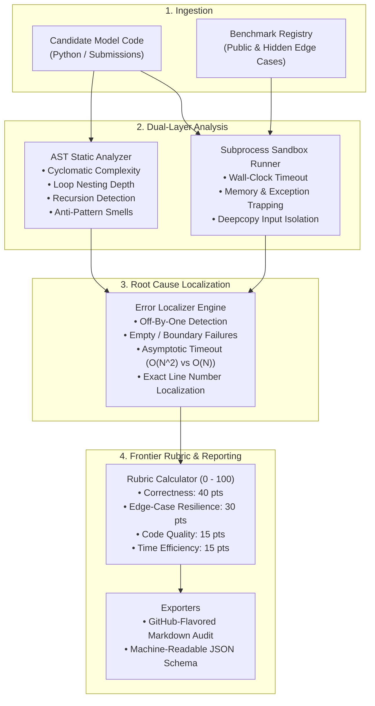

# CodeEval-Bench 🧪⚡
### Automated LLM Code Generation & Reasoning Evaluation Framework

[](https://github.com/thehncoder/codeeval-bench/actions)
[](https://www.python.org/downloads/)
[](LICENSE)
[](tests/)
[](#frontier-evaluation-rubric)

**CodeEval-Bench** is an evaluation harness and benchmark framework designed to test, audit, and benchmark how frontier AI models perform on complex programming, algorithmic reasoning, and edge-case resilience tasks.

Built specifically for AI alignment and model evaluation workflows, CodeEval-Bench moves beyond basic unit tests to perform **AST-level code hygiene inspection**, **sandboxed isolated execution**, **root-cause error localization**, and **multi-dimensional rubric grading** (scoring correctness, boundary resilience, time complexity, and code quality).

---

## 🏛️ System Architecture



---

## ✨ Key Features

- 🛡️ **Safe Subprocess Sandboxing:** Runs candidate code in an isolated subprocess with microsecond timing (`time.perf_counter`), wall-clock timeouts, and input mutation immunity (`copy.deepcopy`).
- 🔍 **Static AST Code Hygiene & Anti-Patterns:** Inspects the Python Abstract Syntax Tree to calculate cyclomatic complexity, loop nesting depth ($O(N^2)$ / $O(N^3)$ heuristic), recursion limits, and antipatterns (bare `except:`, mutable default args, dynamic `eval()`).
- 🎯 **Automated Error Localization:** Classifies failure types and pinpoints root causes:
  - `OFF_BY_ONE`: Detects numerical and array boundary misses (e.g., $actual = expected \pm 1$).
  - `EMPTY_INPUT_FAILURE`: Catches unhandled boundary cases (empty lists, strings, dictionaries).
  - `ASYMPTOTIC_TIMEOUT`: Identifies algorithmic complexity scaling failures.
  - `RECURSION_DEPTH_EXCEEDED`: Flags unmemoized cyclic recursion.
  - `LOGICAL_FLAW`: Flags divergence from expected invariants.
- 📊 **Frontier AI 4-Tier Rubric Scoring:** Calculates a weighted 100-point score across four dimensions:
  1. **Correctness (40 pts):** Overall pass rate on full test suite.
  2. **Edge-Case Resilience (30 pts):** Performance against hidden boundary test cases.
  3. **Code Quality & AST (15 pts):** Syntactic cleanliness, low branching, and clean idioms.
  4. **Time Complexity (15 pts):** Algorithmic execution within required bounds.
- 📝 **Audit Reporting:** Generates audit reports in Markdown and JSON with step-by-step diagnostic rationales and verified golden solutions.

---

## 📂 Curated Benchmark Dataset

| Problem ID | Title | Category | Difficulty | Target LLM Pitfall |
| :--- | :--- | :--- | :---: | :--- |
| `eval-dp-001` | **Constrained Subsequence Maximum Sum** | Dynamic Programming | `HARD` | Initializing `ans = 0` on all-negative inputs; naive $O(N \cdot K)$ loops instead of Monotonic Deque $O(N)$. |
| `eval-graph-002` | **Directed Graph Cycle & Path Lexicography** | Graph Algorithms | `HARD` | Missing disconnected subgraphs; recursion limits on linear graphs; self-loop handling. |
| `eval-string-003` | **Nested Escaped Log Stream Tokenizer** | String Parsing | `MEDIUM` | Crashing on empty strings; failing backslash escape sequences (`\\\\`); consecutive token deduplication. |
| `eval-algo-004` | **Sliding Window Rate Limiter with Cooldown** | Data Structures | `MEDIUM` | Penalty timer reset race conditions; off-by-one window boundaries ($<$ vs $\le$); simultaneous timestamps. |

---

## 🚀 Quickstart

### 1. Installation
Clone the repository and install dependencies:
```bash
git clone https://github.com/thehncoder/codeeval-bench.git
cd codeeval-bench
pip install -r requirements.txt
pip install -e .
```

### 2. Verify Benchmark Integrity
Run the built-in verification suite to ensure all golden reference solutions pass all test cases:
```bash
codeeval verify-golden
```

### 3. List Benchmark Problems
```bash
codeeval list-problems
```

Output:
```text
Loaded 4 Frontier Benchmark Problems:

ID              | Title                                     | Category            | Difficulty | Tests (Public/Hidden)
----------------+-------------------------------------------+---------------------+------------+----------------------
eval-dp-001     | Constrained Subsequence Maximum Sum       | DYNAMIC_PROGRAMMING | HARD       | 6 (3/3)              
eval-graph-002  | Directed Graph Cycle Detection and Pat... | GRAPH_ALGORITHMS    | HARD       | 4 (2/2)              
eval-string-003 | Nested Escaped Log Stream Tokenizer       | STRING_PARSING      | MEDIUM     | 4 (2/2)              
eval-algo-004   | Sliding Window Rate Limiter with Penal... | DATA_STRUCTURES     | MEDIUM     | 3 (1/2)              
```

### 4. Evaluate an AI Submission
Evaluate a sample faulty GPT-4 submission and export a Markdown audit report:
```bash
codeeval eval -p eval-dp-001 -f examples/sample_submissions/faulty_gpt4_dp.py --out-md audit_report.md
```

### 5. Run the Interactive Demo
```bash
python examples/run_demo.py
```

---

## 🧪 Running Unit Tests

The test suite validates AST static analysis, sandbox timeouts, error localization, and benchmark integrity:

```bash
pytest -v
```

Expected output:
```text
============================= test session starts =============================
tests/test_ast_analyzer.py::test_valid_syntax PASSED                     [  7%]
tests/test_ast_analyzer.py::test_syntax_error_detection PASSED           [ 14%]
tests/test_ast_analyzer.py::test_recursion_detection PASSED              [ 21%]
tests/test_ast_analyzer.py::test_loop_nesting_depth PASSED               [ 28%]
tests/test_ast_analyzer.py::test_antipattern_detection PASSED            [ 35%]
tests/test_benchmark_problems.py::test_registry_loading PASSED           [ 42%]
tests/test_benchmark_problems.py::test_all_golden_solutions_pass PASSED  [ 50%]
tests/test_error_localizer.py::test_diagnose_off_by_one PASSED           [ 57%]
tests/test_error_localizer.py::test_diagnose_empty_input_failure PASSED  [ 64%]
tests/test_sandbox.py::test_sandbox_success PASSED                       [ 71%]
tests/test_sandbox.py::test_sandbox_wrong_answer PASSED                  [ 78%]
tests/test_sandbox.py::test_sandbox_runtime_exception PASSED             [ 85%]
tests/test_sandbox.py::test_sandbox_timeout PASSED                       [ 92%]
tests/test_sandbox.py::test_sandbox_missing_entry_point PASSED           [100%]
============================= 14 passed in 2.84s ==============================
```

---

## 📊 Sample Generated Evaluation Report

When `CodeEval-Bench` evaluates a candidate code submission, it generates an audit report:

```markdown
# AI Model Evaluation Report: `eval-dp-001`
**Target Problem:** Constrained Subsequence Maximum Sum  
**Evaluated Model / Submission:** `Simulated-GPT4-Candidate`  
**Final Verdict:** 🟡 PARTIAL (Edge-Case Vulnerabilities)  
**Overall Rubric Score:** `76.67 / 100.0`

## 1. Frontier Evaluation Rubric Breakdown
| Evaluation Dimension | Score | Max Points | Weight / Focus |
| :--- | :---: | :---: | :--- |
| **Correctness & Output Fidelity** | `26.67` | 40.0 | Overall test suite accuracy (4/6 passed) |
| **Edge-Case & Boundary Resilience** | `20.0` | 30.0 | Hidden tests (2/3 passed) |
| **Code Quality & AST Hygiene** | `15.0` | 15.0 | Complexity, recursion, and anti-pattern penalties |
| **Asymptotic Time Efficiency** | `15.0` | 15.0 | Algorithmic scaling within time limit (2.0s) |
| **TOTAL SCORE** | **`76.67`** | **100.0** | **Verdict: PARTIAL** |

## 2. Root Cause Diagnosis & Error Localization
### Bug #1: `BugType.OFF_BY_ONE` (Global / Algorithmic Scope)
- **Root Cause:** Off-by-one error detected: candidate produced 0, which is exactly 1 higher than expected -1.
- **Failing Inputs:** `{'nums': [-1, -2, -3], 'k': 1}`
- **Recommended Fix:** Check range() limits or <= vs < comparison operators in loop conditions.
```

---

## 📁 Repository Structure

```text
codeeval-bench/
├── .github/
│   └── workflows/
│       └── ci.yml                     # GitHub Actions CI matrix (Ubuntu & Windows)
├── codeeval/
│   ├── __init__.py
│   ├── models.py                      # Pydantic schemas: Problem, TestCase, EvaluationReport
│   ├── cli.py                         # Command-Line Interface (list, eval, verify-golden)
│   ├── core/
│   │   ├── __init__.py
│   │   ├── ast_analyzer.py            # AST parsing, complexity metrics, anti-pattern detection
│   │   ├── sandbox.py                 # Subprocess sandbox with wall-clock timeouts & isolation
│   │   ├── error_localizer.py         # Bug classification & line-level root-cause diagnosis
│   │   └── evaluator.py               # Main coordinator for evaluation pipeline
│   ├── benchmark/
│   │   ├── __init__.py
│   │   ├── registry.py                # Problem registry & querying
│   │   └── dataset/
│   │       ├── __init__.py
│   │       └── problems.py            # Benchmark challenge problems with hidden edge cases
│   └── reporting/
│       ├── __init__.py
│       ├── rubric.py                  # 4-tier frontier AI rubric scoring engine
│       └── exporters.py               # Markdown and JSON report generators
├── examples/
│   ├── run_demo.py                    # 1-click end-to-end interactive demo
│   └── sample_submissions/
│       ├── faulty_gpt4_dp.py          # Simulated LLM submission with off-by-one bug
│       └── faulty_claude_string.py    # Simulated LLM submission with edge-case crash
├── tests/
│   ├── test_ast_analyzer.py           # Unit tests for AST analyzer
│   ├── test_sandbox.py                # Unit tests for execution sandbox
│   ├── test_error_localizer.py        # Unit tests for bug diagnosis engine
│   └── test_benchmark_problems.py     # Unit tests verifying all golden solutions pass
├── pyproject.toml                     # Modern Python packaging configuration
├── setup.py                           # Setup & CLI console script definition
├── requirements.txt                   # Production dependencies
├── LICENSE                            # MIT License
└── README.md                          # Documentation
```

---

## 👨‍💻 Author

**Harshit Nigam**  
- Email: [nigamh708@gmail.com](mailto:nigamh708@gmail.com)  
- Focus: AI Model Evaluation, Backend Engineering, Application Security  

